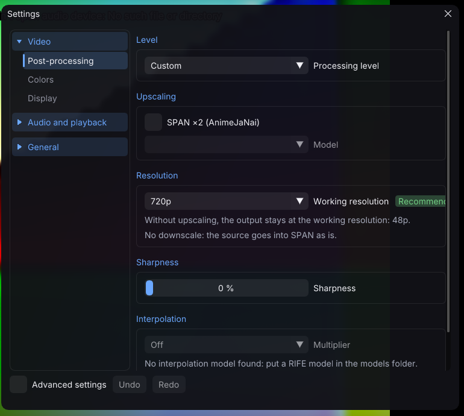

# Ultimate Anime VideoPlayer

[](LICENSE)


Un lecteur vidéo fait pour l'anime. Il agrandit l'image avec les modèles **AnimeJaNai**, ajoute des images
intermédiaires pour une animation fluide et convertit l'anime SDR en **HDR**, en temps réel, sur la carte
graphique de votre PC. Il s'ouvre comme n'importe quel lecteur : double-clic sur une vidéo, et c'est tout.

<p align="center"></p>

## Sommaire

- [Ce qu'il fait](#ce-quil-fait)
- [Installation](#installation)
- [Premier lancement](#premier-lancement)
- [Niveaux de traitement](#niveaux-de-traitement)
- [Le menu](#le-menu)
- [HDR](#hdr)
- [Raccourcis clavier](#raccourcis-clavier)
- [Moteurs et cartes graphiques](#moteurs-et-cartes-graphiques)
- [Mises à jour](#mises-à-jour)
- [Construire depuis les sources](#construire-depuis-les-sources)
- [Remerciements](#remerciements)
- [Licence](#licence)

## Ce qu'il fait

- **Agrandissement ×2** par les modèles SPAN d'AnimeJaNai HD V3.1 : une source 720p ou 1080p devient
  1440p ou 4K, traits nets et aplats propres.
- **Interpolation** par RIFE 4.22 lite, ou 4.25 aux niveaux Qualité et Ultra (DistilDRBA au choix). Le mode Auto vise la fréquence de votre écran et
  redescend tout seul quand la carte ne suit plus. Les coupes de scène et les dessins tenus ne sont pas
  interpolés.
- **HDR anime** : l'anime SDR passe en HDR10 avec un grade guidé plan par plan. Les surfaces restent à leur place,
  seuls les éclats (ciels, lumières, effets) montent. Sur un écran SDR, le même grade s'applique en SDR : les
  surfaces gardent leur niveau jusqu'à 90 % du blanc, le blanc sort à 95 % et les éclats prennent les derniers
  5 %.
- **Netteté** réglable après l'agrandissement, sans halo.
- **Export** : l'agrandissement et l'interpolation rejoués image par image vers un fichier MKV, MP4 ou MOV
  (sans le grade HDR, l'export reste en SDR).
- Sous-titres (libass), choix des pistes par langue préférée, épisode suivant automatique, passage du générique.

## Installation

Téléchargez la dernière version sur la page des [releases](https://github.com/Ta2b/ajp-releases/releases) :

| Système | Fichier | Remarque |
|---|---|---|
| Windows 10 et 11 (x64) | `ajp-windows-x64.zip` | décompresser, lancer `ajp.exe` |
| Linux (x64) | `ajp-linux-x64.tar.gz` | décompresser, lancer `ajp` ; Vulkan et un pilote récent requis |
| macOS 14+ (Apple Silicon) | `ajp-macos-arm64.zip` | `AJP.app` |

Mettez à jour le pilote de votre carte graphique avant le premier lancement. Le lecteur s'installe léger : il
embarque son moteur Vulkan, et le moteur NVIDIA (TensorRT) se télécharge à part si vous le choisissez.

## Premier lancement

Un assistant de quelques écrans, tous sautables :

1. **Moteurs** : sur une carte NVIDIA RTX, TensorRT est proposé (téléchargé depuis NVIDIA après l'accord de
   licence). Les autres cartes utilisent Vulkan, livré avec le lecteur.
2. **Calibration de la machine** : après « Terminer », le lecteur essaie quelques réglages sur une séquence
   exigeante et garde la meilleure combinaison que votre PC tient sans saccade. Quelques minutes, un peu plus la
   première fois (les moteurs se construisent une fois).
3. **Langues** audio et sous-titres préférées, puis **mises à jour**.

Ensuite, `p` ouvre le menu des paramètres et `Tab` les statistiques à l'écran.

## Niveaux de traitement

Le niveau se choisit dans **Vidéo > Post-traitement**. **Auto**, le défaut, prend le niveau de votre carte et
règle la chaîne selon l'écran et la vidéo ouverte. Changer un réglage à la main passe en **Personnalisé**.

| Niveau | Ce qu'il fait | Cartes typiques |
|---|---|---|
| Économe | la vidéo telle quelle, ni agrandissement ni interpolation | graphiques intégrés d'entrée de gamme, GT, MX |
| Rapide | SPAN depuis 540p, interpolation jusqu'à ×2 | GTX 10 et 16, RX 5000, Arc A3, Iris Xe |
| Normal | SPAN depuis 720p, interpolation jusqu'à ×3 | RTX 20 à 50 d'entrée de gamme, RX 6600 à 7600, Arc A5/A7/B5, Apple M |
| Qualité | SPAN depuis 720p, interpolation jusqu'à ×4 | RTX 3070 à 4070, RTX 5070, RX 6800 à 7800, Apple Pro et Max |
| Ultra | SPAN jusqu'à 1080p, interpolation jusqu'à ×4 | RTX 4080 à 5090, RX 7900, RX 9070, Apple Ultra |

La résolution de travail suit votre écran : SPAN double l'image, donc 720p pour un écran 1440p.

## Le menu

| Catégorie | Pages |
|---|---|
| **Vidéo** | Post-traitement (niveau, agrandissement, netteté, interpolation), Couleurs (saturation, contraste, éclats), Affichage (filtre final, débandage ; noir OLED en avancé) |
| **Audio et lecture** | Son (sortie, délai, calage sur l'écran), Lecture (langues, sous-titres, épisode suivant) |
| **Général** | Application (langue, mises à jour, lecteur par défaut), Moteurs, Export, Statistiques, À propos |

Les réglages qui s'appliquent en direct changent l'image tout de suite ; ceux qui demandent de recharger la
chaîne attendent « Appliquer ». La case **Réglages avancés** montre le reste.

## HDR

Il n'y a pas de bouton HDR : le lecteur suit votre système.

- HDR activé dans Windows (ou dans votre bureau Linux) sur un écran d'au moins 350 nits : sortie **HDR10**.
- HDR coupé, écran SDR, ou écran « HDR » trop peu lumineux : sortie **SDR**, avec le même grade.
- Allumer ou couper le HDR pendant la lecture bascule la sortie en direct.

Le pic de l'écran se lit dans le système (étalonnage HDR de Windows, EDID) ; il se règle à la main dans les
réglages avancés.

## Raccourcis clavier

| Touche | Action |
|---|---|
| Espace | pause |
| ← → | reculer, avancer de 5 s |
| ↑ ↓ | volume |
| `m` | muet |
| `f` | plein écran (Échap en sort) |
| `a` / `j` | piste audio / sous-titres suivants |
| `z` / `x` | sous-titres 100 ms plus tôt / plus tard |
| `Ctrl` + `-` / `Ctrl` + `+` | son 100 ms plus tôt / plus tard |
| `n` / Maj+`n` | épisode suivant / précédent |
| Page↑ / Page↓ | chapitre suivant / précédent |
| `o` | passer le générique |
| `.` / `,` | image par image |
| `p` | paramètres |
| Tab | statistiques |
| Ctrl+0 | sans traitement |
| Ctrl+G / Ctrl+I | grade / interpolation |
| `q` | quitter |

Les raccourcis se changent dans `user.toml` (section `[keys]`, dossier des données du lecteur).
`ajp --help` liste aussi les options de la ligne de commande.

## Moteurs et cartes graphiques

| Carte | Moteur | Livraison |
|---|---|---|
| NVIDIA RTX | TensorRT (CUDA) | téléchargé au premier lancement : notre module, puis les bibliothèques de NVIDIA |
| AMD, Intel, NVIDIA sans TensorRT | Vulkan | livré avec le lecteur |
| Apple Silicon | Core ML | livré avec le lecteur macOS |

Le premier lancement de TensorRT construit ses moteurs pour votre carte : quelques minutes, une seule fois.
Détails : [`docs/moteurs.md`](docs/moteurs.md).

## Mises à jour

Au démarrage, le lecteur regarde s'il existe une nouvelle version et vous prévient (ou l'installe au lancement
suivant, ou ne fait rien : Général > Application). Les manifestes sont signés (Ed25519) ; vos réglages sont
gardés.

## Construire depuis les sources

Prérequis : CMake 3.28+, Ninja, un compilateur C++23 (GCC 13+, Clang 20+, MSVC 17.10+).

```sh
# Linux, dépendances construites depuis leurs dépôts
tools/deps/linux-from-source.sh ~/ajp-deps
export AJP_DEPS_PREFIX=~/ajp-deps
cmake --preset linux-prefix && cmake --build --preset linux-prefix
ctest --preset linux-prefix
# linux-prefix est en Debug : pour un banc ou une mesure, le binaire livré (Release)
cmake --preset linux-release && cmake --build --preset linux-release

# Windows et CI, avec vcpkg
cmake --preset debug && cmake --build --preset debug && ctest --preset debug

# macOS (Apple Silicon)
tools/deps/macos-from-source.sh ~/ajp-deps
AJP_DEPS_PREFIX=~/ajp-deps tools/release/package-macos.sh
```

Les paquets se font avec `tools/release/package-linux.sh` et `package-windows.ps1` ; le paquet TensorRT avec
`tools/release/trt-package.sh` sur un poste NVIDIA. Aucun fichier de NVIDIA n'est dans nos archives.

Pour reprendre le code : [`CLAUDE.md`](CLAUDE.md) (guide de reprise), [`docs/README.md`](docs/README.md) (carte
des documents), [`docs/ARCHITECTURE.md`](docs/ARCHITECTURE.md) et [`docs/adr/`](docs/adr/README.md).

## Remerciements

- [the-database](https://github.com/the-database) pour les modèles **AnimeJaNai** et
  [mpv-AnimeJaNai](https://github.com/the-database/mpv-AnimeJaNai), dont ce lecteur est parti.
- [hzwer](https://github.com/hzwer/Practical-RIFE) pour **RIFE**, et routineLife1 pour **DistilDRBA**.
- [AmusementClub/vs-mlrt](https://github.com/AmusementClub/vs-mlrt) pour les conversions ONNX de RIFE.
- [libplacebo](https://code.videolan.org/videolan/libplacebo) (composition, filtres, hooks mpv),
  [FFmpeg](https://ffmpeg.org), [libass](https://github.com/libass/libass), [SDL3](https://libsdl.org),
  [Dear ImGui](https://github.com/ocornut/imgui), spdlog, toml++ et dav1d.

## Licence

Le code est sous [Mozilla Public License 2.0](LICENSE). Les modèles gardent leur licence : AnimeJaNai est sous
**CC BY-NC-SA 4.0** (usage non commercial), RIFE et DistilDRBA sous MIT. Le détail de chaque composant tiers est
dans [`THIRD_PARTY_NOTICES.md`](THIRD_PARTY_NOTICES.md).
